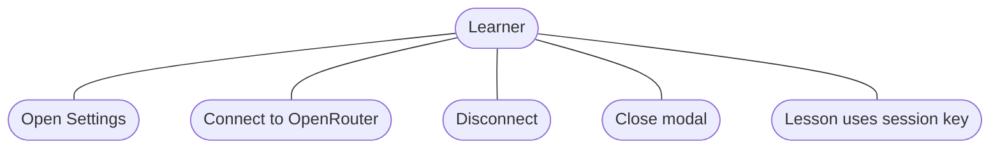
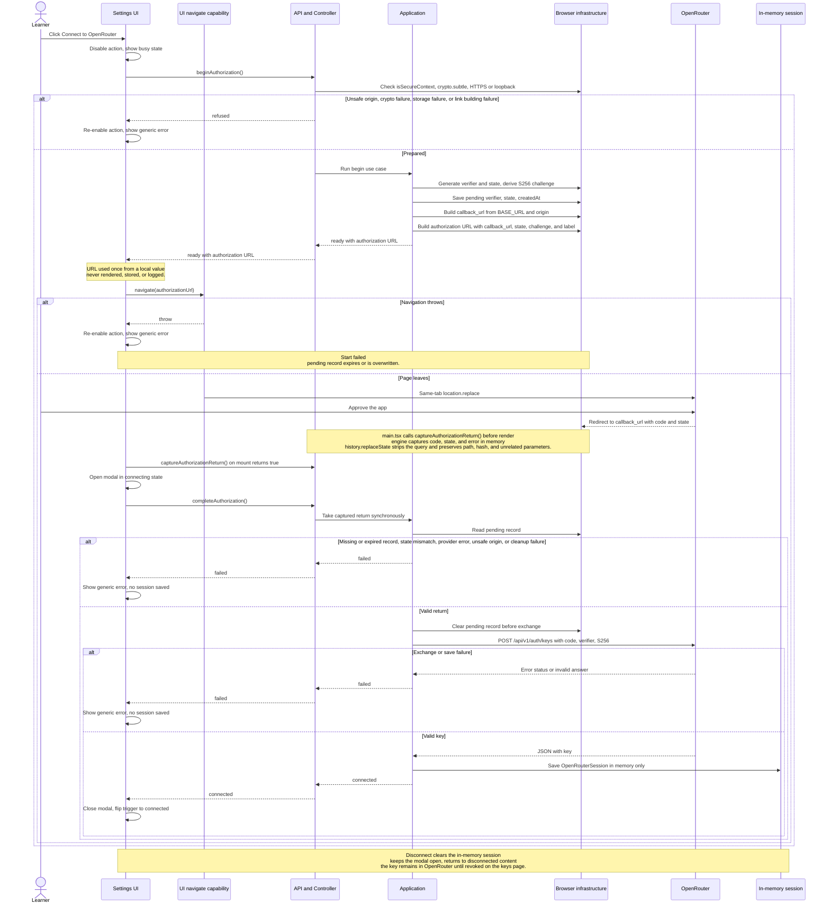

# 016 - OpenRouter OAuth target flow

Target state after Tasks 1 to 9 of `016-openrouter-oauth.md`.
The two views below are complementary: the use cases and the OAuth round trip.

## 1. Use cases

## 2. OAuth round trip

## Product copy

| State | User-visible copy | Actions |
| --- | --- | --- |
| Disconnected | Title: `Connect to OpenRouter`. Body: `Connect your OpenRouter account to use your own credits for lessons.` Footnote: `Your key stays in memory for this tab and is never saved. Reloading disconnects it.` | `Connect to OpenRouter` |
| Connecting | Title: `Connecting to OpenRouter`. Body: `Finishing sign-in. This takes a moment.` | None |
| Connected | Title: `OpenRouter connected`. Body: `Your OpenRouter account is connected. Your key stays in memory for this tab and is never saved. Reloading disconnects it.` Note: `Disconnecting forgets the key in this tab. The key stays in your OpenRouter account until you revoke it.` | `Disconnect`, `Revoke in OpenRouter` |
| Failure | Error under the action: `Could not connect to OpenRouter. Please try again.` | Retry with the main action |

- Trigger names: `Settings, OpenRouter not connected` and
  `Settings, OpenRouter connected`.
- Tooltips: `OpenRouter sign-in` and `OpenRouter account`.
- Close button: `Close settings`.
- Revocation link opens `https://openrouter.ai/keys` in a new tab with
  `rel="noopener noreferrer"` and the accessible name
  `Revoke in OpenRouter (opens in a new tab)`.
- Close paths: cross, Escape, and backdrop. A click inside the panel does not
  close. Focus returns to the trigger, and focus moves to the Connect action
  after Disconnect.

## Invariants

- The UI never receives the key, code, verifier, or session directly.
- The engine prepares the one-shot authorization URL. The UI performs a
  same-tab `location.replace` through an injected `navigate` capability, and
  never parses the URL, reads `state`, stores, renders, or logs the URL.
- `captureAuthorizationReturn` is synchronous and idempotent. It runs after
  the browser returns and before the first render, and its answer feeds
  `completeAuthorization`; a cleanup failure never starts an exchange.
- Only the verifier, state, and creation time touch `sessionStorage`. The
  record is removed before the exchange and expires after ten minutes.
- `beginAuthorization` answers `ready` or `refused`; `completeAuthorization`
  answers `none`, `failed`, or `connected`; neither entry rejects.
- A navigation throw is a UI start failure: the action re-enables, the generic
  error appears, no session is stored, and any pending record expires or is
  overwritten.
- The exchange has no Authorization header, omits credentials, refuses
  redirects, uses CORS, sends no referrer, disables cache, aborts after fifteen
  seconds, and never retries.
- Failure logs contain only an HTTP status and a safe local cause name.
- The UI has one connection error:
  `Could not connect to OpenRouter. Please try again.`
- The key is memory-only. Reload disconnects the tab.
- The development environment key is a fallback only under
  `import.meta.env.DEV`. Production never uses it. No build-time guard is added.
- The connected view links to `https://openrouter.ai/keys` for revocation.
- Tests stay offline and never call OpenRouter.
